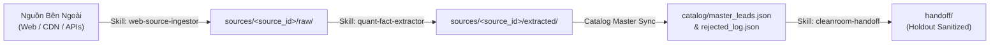

# AGENTS INSTRUCTION & WORKFLOW SPECIFICATION

> **Kho lưu trữ:** `strategy-intel` (Kho thu thập & kiểm toán thông tin chiến lược định lượng từ các nguồn bên ngoài)  
> **Nguyên tắc an toàn tối thượng:** Tuân thủ tuyệt đối [.agents/rules/intel-airgap-guardrails.md](.agents/rules/intel-airgap-guardrails.md).

---

## 1. MỤC TIÊU CỦA HỆ THỐNG
`strategy-intel` đóng vai trò là "Vùng Đệm Phòng Sạch" (Clean-room Intelligence Buffer). Mục tiêu duy nhất là:
1. Thu thập dữ liệu công khai từ các nguồn web, kho EA, báo cáo định lượng bên ngoài.
2. Kiểm toán phương pháp luận, tách bạch sự thật (Fact) khỏi các chiêu trò tiếp thị (Marketing/Overfitting).
3. Trích xuất các ý tưởng có giá trị (Leads) đạt chuẩn định lượng, loại bỏ hoàn toàn bẫy Grid/Martingale và Curve-Fitting.
4. Đóng gói tài liệu bàn giao sang `handoff/` cho đội ngũ Quant nội bộ mà **không làm ô nhiễm tập Holdout 2025–2026**.

---

## 2. QUY TRÌNH LÀM VIỆC THEO 3 KỸ NĂNG (SKILLS)

1. **`web-source-ingestor`**:
   - Sử dụng browser built-in hoặc HTTP clients để crawl cấu trúc DOM, API chunks.
   - Lưu trữ văn bản thô, JSON payloads vào `sources/<source-name>/raw/`.
   - **Chặn tuyệt đối:** Mọi URL tải file nhị phân (`.ex4`, `.ex5`, `.zip`, `.exe`).

2. **`quant-fact-extractor`**:
   - Viết các script tự động (Python/Node) đọc từ `raw/` và sinh các tệp trong `extracted/`.
   - Điền `NOT_DISCLOSED` cho các trường thiếu; cấm đoán số hay tự tạo code minh họa.
   - Đối chiếu SHA-256 đảm bảo tính toàn vẹn.

3. **`cleanroom-handoff`**:
   - Tổng hợp các ý tưởng chất lượng cao vào `catalog/master_leads.json`.
   - Ghi nhận các chiến lược rác/nguy hiểm vào `catalog/rejected_log.json`.
   - Chạy `holdout_sanitizer.py` để làm sạch toàn bộ dữ liệu 2025–2026 trước khi đưa vào `handoff/`.

---

## 3. BỘ 3 SCRIPT KIỂM ĐỊNH DÙNG CHUNG (`scripts/common/`)

Trước khi kết thúc bất kỳ lượt làm việc nào hoặc trước khi commit git, Agent bắt buộc phải chạy 3 script sau:
1. `python scripts/common/repo_hygiene_check.py`:
   - Xác nhận 0 tệp nhị phân (`.ex4`, `.ex5`, `.dll`, `.exe`, `.zip`, `.rar`, `.mq4`, `.mq5`, `.msi`).
   - Xác nhận 0 tệp nháp ngoài `.scratch/`.
2. `python scripts/common/verify_verbatim.py`:
   - Xác nhận mọi trường dữ liệu trong `extracted/` không bị rỗng/bịa; đối chiếu checksum `raw/`.
3. `python scripts/common/holdout_sanitizer.py`:
   - Quét thư mục `handoff/` đảm bảo không có bất kỳ chuỗi PnL/kết quả của năm `2025` hoặc `2026`.

---
*Mọi hành động vi phạm guardrails sẽ bị hệ thống tự động từ chối.*
